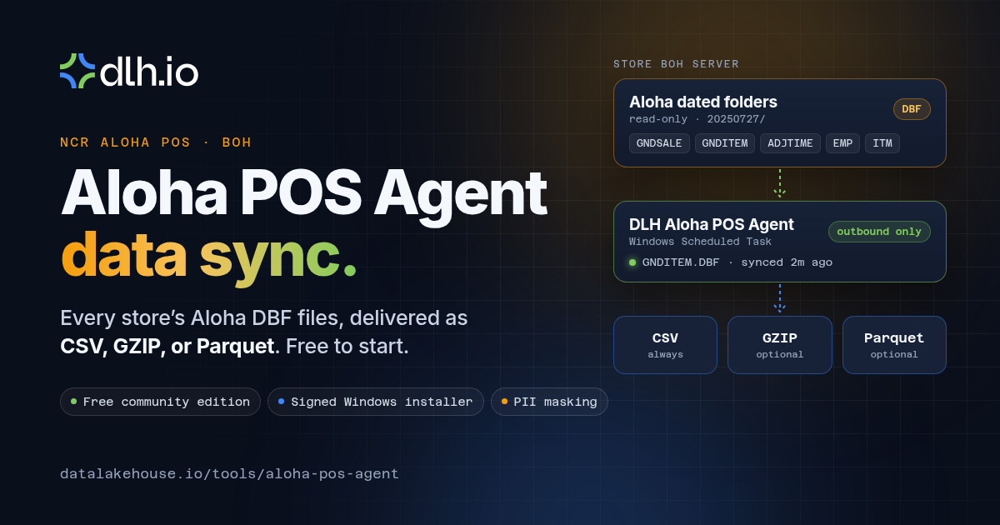

<picture>
  <source media="(prefers-color-scheme: dark)" srcset="assets/dlh_logo_white.svg">
  
</picture>

# DLH.io Agent for Aloha POS



**Free data sync for NCR Aloha POS, from DBF to Parquet**

## What it does

The agent reads NCR Aloha back-of-house DBF files with read-only access and
sends data over outbound-only connections. Its signed Windows installer
produces CSV, GZIP-compressed CSV, or Apache Parquet and supports data
consolidation across stores.

- [Product page](https://datalakehouse.io/tools/aloha-pos-agent)
- [Documentation](https://datalakehouse.io/docs/connectors/applications/aloha-pos/aloha-pos-agent)
- [Aloha POS data model and ERD](https://datalakehouse.io/docs/connectors/applications/aloha-pos#schema-details-er-diagram)

## Editions

The free community edition needs no API key. It processes up to 100 records
per DBF file and keeps output in the local output folder. Add a valid DLH.io
API key in the configuration to enable unlimited extraction and cloud upload.

[Request a Demo](https://datalakehouse.io/tools/aloha-pos-agent)

## Download

<!-- latest-release:start -->
**Version:** `v20261119.1621`
**Published (UTC):** 2026-11-19 16:25:15 UTC

| File | SHA256 | Download |
| --- | --- | --- |
| Windows installer | `cc93bf62353a7bbee05fd3b3732194e7c71b3efe423f11af4574980dc6fa9c1d` | [Download](https://github.com/datalakehouse/dlh-agent-aloha-pos-installer/releases/download/v20261119.1621/dlh-agent-for-aloha-pos-installer-v20261119.1621.exe) |
| PowerShell bootstrap | `c6c961f2fc709e7afb1121f6951d809f494f33dbe36c4de0cf50e624c64a3d1a` | [Download](https://github.com/datalakehouse/dlh-agent-aloha-pos-installer/releases/download/v20261119.1621/Install-DlhAgentAlohaPos.ps1) |
| Setup guide PDF | `786794b3f484d702eb21141fabf0752cc06b5c94f59ea540789a84d558b71985` | [Download](DLH-Aloha-POS-Agent-Setup-Guide.pdf) |

### Quick install

```powershell
$tag = 'v20261119.1621'
$base = "https://github.com/datalakehouse/dlh-agent-aloha-pos-installer/releases/download/$tag"
Invoke-WebRequest "$base/Install-DlhAgentAlohaPos.ps1" -OutFile .\Install-DlhAgentAlohaPos.ps1
.\Install-DlhAgentAlohaPos.ps1 -InstallerUrl "$base/dlh-agent-for-aloha-pos-installer-$tag.exe" -ExpectedSha256 'cc93bf62353a7bbee05fd3b3732194e7c71b3efe423f11af4574980dc6fa9c1d'
```
<!-- latest-release:end -->

Browse all files on the [Releases page](https://github.com/datalakehouse/dlh-agent-aloha-pos-installer/releases)
or read the [Setup Guide](DLH-Aloha-POS-Agent-Setup-Guide.pdf).

## Install (recommended)

Run this from an elevated PowerShell prompt on the Aloha back-of-house server:

```powershell
$tag = 'v<version>'
$base = "https://github.com/datalakehouse/dlh-agent-aloha-pos-installer/releases/download/$tag"
Invoke-WebRequest "$base/Install-DlhAgentAlohaPos.ps1" -OutFile .\Install-DlhAgentAlohaPos.ps1
.\Install-DlhAgentAlohaPos.ps1 -InstallerUrl "$base/dlh-agent-for-aloha-pos-installer-$tag.exe" -ExpectedSha256 '<installer SHA256>'
```

The bootstrap checks the installer SHA256 and verifies its
`DLH.io (AICG, Inc.)` signature before Setup starts. It installs silently and
returns Setup's exit code. Downloading the installer through the bootstrap
does not trigger the SmartScreen download prompt.

## Install (manual download)

Download the installer EXE from the
[Releases page](https://github.com/datalakehouse/dlh-agent-aloha-pos-installer/releases).
Compare its hash with the published SHA256 value, and check its signature:

```powershell
$installer = '.\dlh-agent-for-aloha-pos-installer-<version>.exe'
Get-FileHash $installer -Algorithm SHA256
Get-AuthenticodeSignature $installer | Format-List Status, StatusMessage, SignerCertificate
```

Confirm the signer is `DLH.io (AICG, Inc.)`. If Windows displays "Windows
protected your PC", select **More info**, confirm the publisher, then select
**Run anyway**. You can also use `Unblock-File` after verifying the hash and
signature. To run the bootstrap with an EXE you already downloaded, use its
`-InstallerPath` option:

```powershell
.\Install-DlhAgentAlohaPos.ps1 -InstallerPath '.\dlh-agent-for-aloha-pos-installer-<version>.exe' -ExpectedSha256 '<installer SHA256>'
```

## Why the SmartScreen prompt appears

Each new signed build starts with no download reputation, so SmartScreen may
show an unrecognized-app prompt while reputation develops. The installer is
signed with Microsoft Artifact Signing, but signing does not guarantee that
the prompt will disappear.

## Setup and configuration

Start with the [Setup Guide](DLH-Aloha-POS-Agent-Setup-Guide.pdf). In
`dlh_agent_config.toml`, set `dir_main` to the parent folder containing the
dated Aloha DBF folders. A valid `[dlhapi].api_key` enables unlimited extraction
and cloud upload. `[dlhagent].output_file_formats` accepts `csv`, `gzip`, and
`parquet`; new installs default to `["csv", "gzip"]`.

## Previous versions

Earlier root copies of the bootstrap script, `SHA256SUMS.txt`, and setup guide
are stored in `archive/<version>/`, where the version omits the leading `v`.
Older installer binaries remain available on the
[Releases page](https://github.com/datalakehouse/dlh-agent-aloha-pos-installer/releases).

## Support

Open a [GitHub issue](https://github.com/datalakehouse/dlh-agent-aloha-pos-installer/issues).
Do not include API keys, configuration secrets, or customer data in an issue.
See the [DLH.io Trust Center](https://trust.inc/dlh) and the
[Data Processing Addendum](https://datalakehouse.io/legal/data-processing-addendum).

## Terms

The DLH.io Aloha POS Agent and its installer are proprietary software of
AICG, Inc. (DLH.io). The community edition is free to use. See [LICENSE](LICENSE)
and the [DLH.io Terms and Conditions](https://datalakehouse.io/legal/terms-and-conditions).

The PowerShell bootstrap script `Install-DlhAgentAlohaPos.ps1` is licensed under
the MIT License, so your IT team can review and adapt it.
